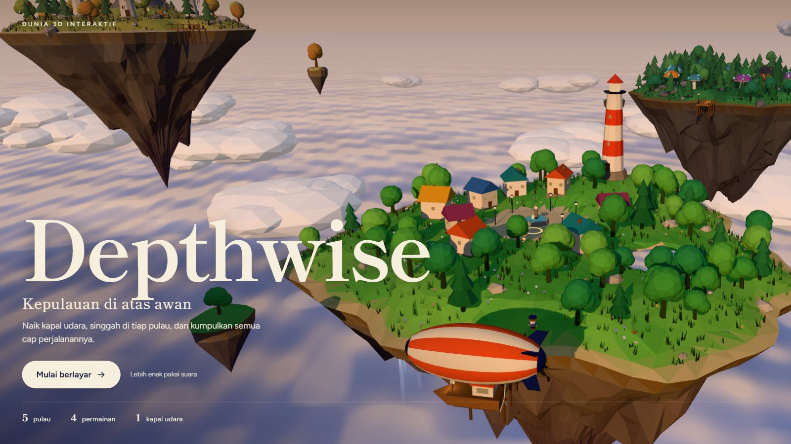
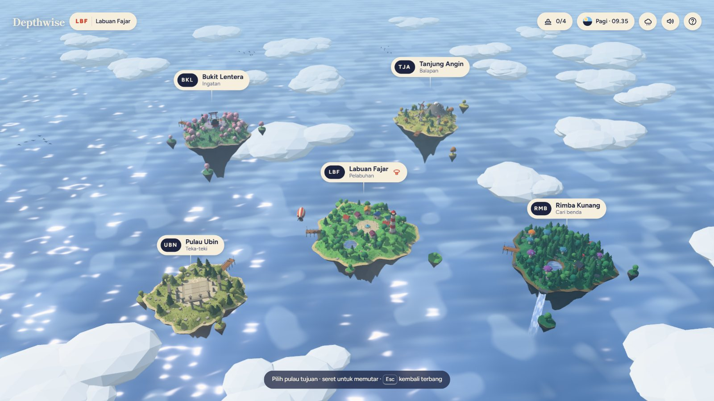
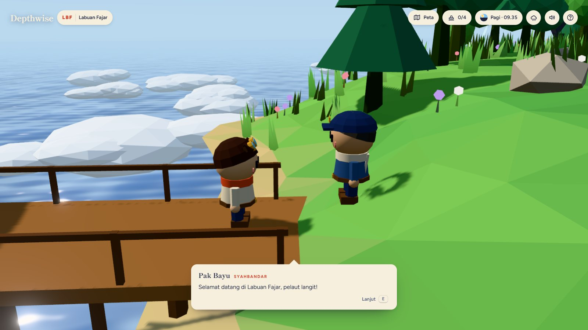
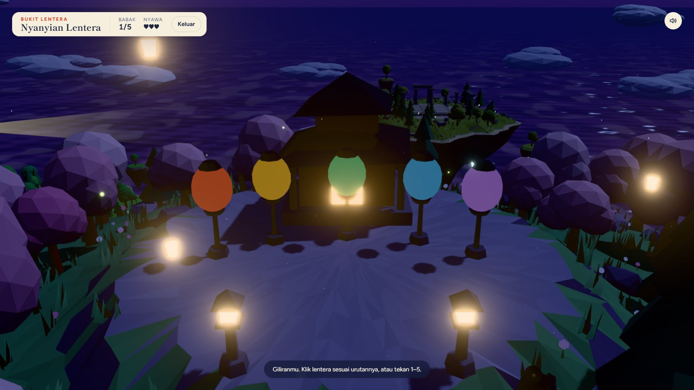
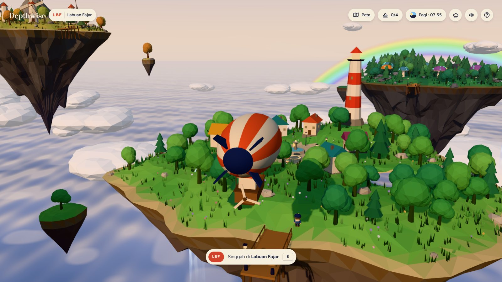
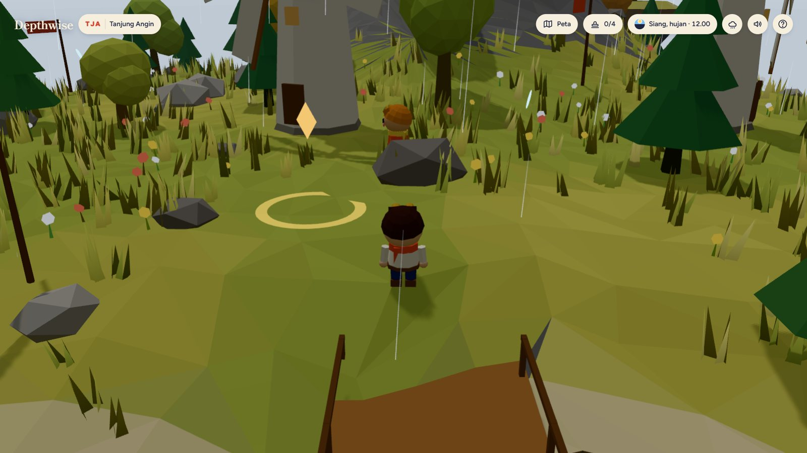
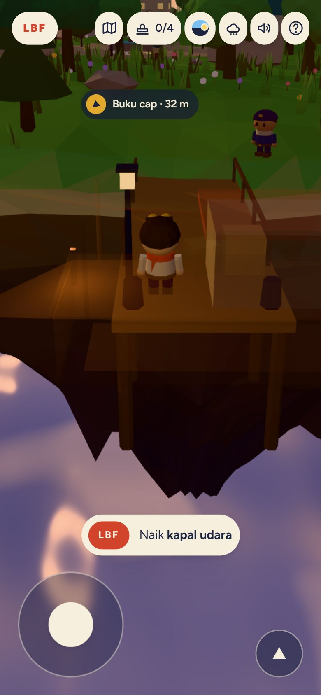

# Depthwise

[](https://depthwisee.vercel.app)

A small 3D world in the browser: five floating islands above a sea of clouds, an airship you steer yourself, and a sky sailor you walk around each island as. Fly between islands, chat with the islanders, play four mini games to fill your stamp book, then sail home to the harbour for the finale.

Every model, texture, and sound is generated in code. The repo contains no 3D asset or audio files at all.

Built with Three.js, GSAP, TypeScript, and Vite, no UI framework.

### [▶ Live demo: depthwisee.vercel.app](https://depthwisee.vercel.app)

> The interface is in Indonesian (Bahasa Indonesia).

## Features

- **Free flight.** Steer the airship with WASD or a touch joystick. It has inertia, banks into turns, and is kept clear of islands, islets, and the lighthouse. Pick an island on the map instead and the ship flies there on its own along a smooth curve
- **Walk every island.** Dock with `E` and the sailor hops onto the pier. Walk, run, jump, and climb stairs tread by tread while the camera swings in behind you. Bumping into a house or tree slides you along it instead of stopping you dead
- **Four mini games**, one per island, each loaded only when you play it
  - **Ubin Geser**: a 3×3 sliding puzzle that restores a mosaic courtyard
  - **Kristal Kunang**: find six crystals hidden around a forest island
  - **Balap Cincin**: race the airship through a ring course
  - **Nyanyian Lentera**: repeat the order in which lanterns light up and sing
- **Islanders.** Six characters live on the islands. They stroll around, turn to face you, and talk when you press `E`. What they say depends on your progress: your records, stamps, and how many feathers you have found
- **Wind feathers and costumes.** Fifteen feathers are hidden across the islands, one per island only reachable with a jump. Each stamp unlocks a new jacket and scarf colour, and collecting every feather unlocks one more
- **Day and night.** A full day passes in seven minutes, or press `T` to skip ahead. Windows, lamps, and lanterns light up after dark, stars and fireflies come out, and paper lanterns rise from the hill
- **Weather.** Clear skies, overcast, rain, and mist come and go on their own (or press `C`). Rain dims the sun and hides the stars, mist swallows distant islands, and when the rain clears on a sunny day a rainbow appears opposite the sun
- **Wildlife.** Small birds hop about every island and scatter when you or an islander walk up, then come back once it is quiet. Butterflies drift over the grass by day
- **Music that follows you.** The soundtrack is generated live. Each island has its own scale, chord, and pace, and the pad retunes smoothly as you fly from one to the next. Rain, footsteps, and wing beats are synthesized too
- **Mobile friendly.** Touch joystick, a jump / climb button, a compact top bar that fits 320 px wide phones, and a render resolution that drops on its own if the frame rate cannot keep up
- **Progress is saved** in `localStorage`: stamps, records, feathers, costume, and sound setting

## Screenshots

| | |
|---|---|
|  |  |
|  |  |
|  |  |

## Running locally

Requires Node.js 20.19 or newer, or 22.12 or newer (a Vite 8 requirement).

```bash
npm install
npm run dev
```

Open the address printed in the terminal (usually http://localhost:5173).

Other scripts

```bash
npm run build       # type check, then production build to dist/
npm run preview     # serve the build locally
npm run typecheck   # TypeScript only
npm test            # unit tests (Vitest)
```

The build uses `base: './'`, so `dist/` also works from a subfolder (GitHub Pages, for example).

### Development shortcuts

URL parameters that jump straight to the part you are working on

| Parameter | Effect |
|---|---|
| `?island=ubin` | Start at an island (`hub`, `ubin`, `rimba`, `angin`, `lentera`) |
| `?autostart` | Skip the title screen |
| `?time=0.8` | Lock the time of day (0 midnight, 0.5 noon) |
| `?weather=hujan` | Lock the weather (`cerah`, `mendung`, `hujan`, `kabut`) |
| `?stats` | Show FPS, draw calls, resolution, and GPU name, handy for testing on a phone |

In development the app instance is available in the console as `window.depthwise`.

## Controls

| Action | Airship | On foot | Touch |
|---|---|---|---|
| Move | `W` `S` forward / back, `A` `D` turn | `W` `A` `S` `D`, relative to the camera | Joystick |
| `Space` | Climb | Jump | Up / jump button |
| `Shift` | Descend | Run | Down button (airship) |
| `E` or `Enter` | Dock at the nearest island | Play at the golden ring, talk to an islander, or board at the end of the pier | Prompt at the bottom |
| `Esc` | | Board the airship and take off | |
| Look around / zoom | Drag / scroll | Drag / scroll | Drag / pinch |
| Map | `M` (click an island to fly there) | `M` | Map button |
| Time of day | `T` | `T` | Clock button |
| Weather | `C` | `C` | Cloud button |

Arrow keys work like `WASD`. The key list appears briefly in the bottom left whenever the controls change.

## Islands

| Code | Island | Game |
|---|---|---|
| LBF | Labuan Fajar | The harbour where you start. Its lighthouse burns brighter once every stamp is collected |
| UBN | Pulau Ubin | **Ubin Geser**: click a tile or use the arrow keys |
| RMB | Rimba Kunang | **Kristal Kunang**: orbit the camera to spot the crystals |
| TJA | Tanjung Angin | **Balap Cincin**: steer with the mouse, touch, or WASD |
| BKL | Bukit Lentera | **Nyanyian Lentera**: click the lanterns or press 1 to 5 |

## Technical notes

The parts most worth reading in the code

- **Analytic islands** ([Island.ts](src/world/Island.ts)). Each island is a height function (plateau, noise hills, bumps, pits, flattened building pads) over a wobbly rim, with an inverted rocky mountain underneath. Because the ground height is a formula, props, characters, birds, and butterflies are placed exactly on the surface without any raycasting
- **Walking without a physics engine** ([Walk.ts](src/world/Walk.ts)). The ground is the island's height function plus rotated rectangle platforms (the pier, the mosaic courtyard) and stairs with a stepped tread profile. Obstacles are circles. A blocked move is retried one axis at a time, so the character slides along walls, and steps taller than 0.7 m stop you. Islanders use the same `Walker`, so they avoid houses and trees too
- **A camera that never hides the character** ([App.ts](src/App.ts)). On foot, a ray from the character to the camera is tested against tree crowns and buildings each frame. The camera snaps in front of whatever blocks the view, then eases back out once it clears. The moored airship is handled separately: when an ellipsoid around it crosses the line of sight, the ship's own material fades out. Flipping a Three.js material between opaque and transparent needs a shader recompile, which [Airship.ts](src/world/Airship.ts) triggers only on the frame it changes
- **Conversations** ([Npc.ts](src/world/Npc.ts), [content.ts](src/content.ts)). Talking steps both characters to a set distance, turns them to face each other, and swings the camera side-on around their midpoint, choosing whichever side has fewer obstacles. Dialogue lines are functions of your progress
- **Rain in one draw call** ([Weather.ts](src/world/Weather.ts)). Every raindrop is a line segment in a box that follows the camera. The vertex shader moves the drops down with time and wraps them around the box with `mod`, so the CPU never touches them. Weather logic (`WeatherCycle`) is separate from rendering and unit tested. It eases cloud, rain, and mist levels, which then grey and darken the sky, light, fog, and water colours from the day-night cycle
- **Wildlife** ([Wildlife.ts](src/world/Wildlife.ts)). Birds are a small state machine (on the ground, flying, away) drawn with two `InstancedMesh`es, one for bodies and one for wings that flap on the CPU. Butterflies flap in the vertex shader. All of it is three draw calls
- **Day and night** ([DayNight.ts](src/core/DayNight.ts)). One time value from 0 to 1 is interpolated through keyframes into sky, fog, sun, and hemisphere light colours. The sun and moon hand over as the directional light while it fades to zero at the horizon, which hides the switch
- **Instancing everywhere** ([vegetation.ts](src/world/vegetation.ts), [Clouds.ts](src/world/Clouds.ts)). Trees, grass, rocks, and clouds use `InstancedMesh`, and each island's buildings are merged into a handful of meshes. A full island scene renders in about 100 draw calls
- **Generated audio** ([AudioEngine.ts](src/core/AudioEngine.ts)). Everything is Web Audio: a detuned triangle pad, a bell melody that wanders along each island's scale, filtered noise for wind, rain, and footsteps, and a feedback delay for a sense of open air
- **Loading** ([vite.config.ts](vite.config.ts), [games/index.ts](src/games/index.ts)). Three.js and GSAP go into a separate `vendor` chunk that stays cached between deploys. Each mini game is a dynamic import, prefetched when you step onto its play spot. A counter drops a game that finishes loading after you have already walked away
- **Performance.** Frame time is sampled every 90 frames. If it stays under 40 FPS twice in a row, the pixel ratio drops by 0.25 (down to 0.75). Phones start at a pixel ratio of at most 1.5 and get fewer raindrops

## Deployment

The live version is hosted on Vercel with the Vite preset and no extra configuration. The project is connected to this GitHub repo, so every push to `main` deploys to production and other branches get a preview URL. To deploy by hand from the project folder

```bash
vercel deploy --prod
```

[.vercelignore](.vercelignore) keeps the screenshots in `docs/` from being uploaded.

## Project structure

```
src/
├── main.ts              entry point: fonts, styles, and the App
├── App.ts               modes (title, flight, map, travel, island, game), input, camera, main loop
├── content.ts           islands, islanders and their lines, costumes (single source for all text)
├── styles.css
├── core/
│   ├── AudioEngine.ts   synthesized music, ambience, and sound effects
│   ├── CameraRig.ts     orbit camera, flights, and following a target
│   ├── DayNight.ts      time of day and every colour derived from it
│   ├── Input.ts         keyboard, pointer, drag, and pinch
│   ├── Store.ts         saved progress in localStorage, validated on load
│   └── math.ts          seeded random, noise, easing helpers
├── world/
│   ├── World.ts         the scene: lights, fog, islands, ship, characters, per-frame updates
│   ├── islands.ts       builds all five islands, their props, obstacles, and play spots
│   ├── Island.ts        analytic height field and island mesh
│   ├── props.ts         houses, lighthouse, windmills, stairs, lanterns, and more
│   ├── vegetation.ts    instanced trees, grass, flowers, and rocks
│   ├── mosaic.ts        the Pulau Ubin courtyard mosaic
│   ├── Airship.ts       the airship, its animation, and see-through fade
│   ├── Flight.ts        free flight with inertia and collisions
│   ├── Walk.ts          walking: ground, platforms, stairs, obstacles, jumping
│   ├── Character.ts     the chibi sky sailor, built from primitives and animated in code
│   ├── Npc.ts           islanders that wander and face the player
│   ├── Feathers.ts      collectable wind feathers
│   ├── Beacon.ts        the golden ring that marks each game spot
│   ├── Weather.ts       weather cycle, rain, and rainbow
│   ├── Wildlife.ts      birds and butterflies
│   ├── Sky.ts           sky dome shader, sun, moon, and stars
│   ├── Water.ts         ocean and waterfall shaders
│   ├── Clouds.ts        drifting instanced clouds
│   ├── ambient.ts       bird flocks, fireflies, paper lanterns, fireworks
│   ├── Dust.ts          pooled dust puffs for landing and running
│   ├── geo.ts           geometry merging helpers
│   └── materials.ts     shared materials and glow uniforms
├── games/
│   ├── index.ts         lazy loading for the mini games
│   ├── types.ts         the interface every game implements
│   ├── SlidingPuzzle.ts Ubin Geser
│   ├── puzzleLogic.ts   solvable shuffles and moves for the puzzle
│   ├── HiddenCrystals.ts Kristal Kunang
│   ├── RingRace.ts      Balap Cincin
│   └── LanternMemory.ts Nyanyian Lentera
└── ui/
    ├── UI.ts            every DOM element outside the canvas
    ├── PerfStats.ts     the ?stats readout
    └── icons.ts         inline SVG icons
tests/                   unit tests for the pure logic (walking, flight, weather, wildlife, puzzle, storage, content)
```

## Credits

- Made by Rafif Shula Syandana
- Fonts: [Shippori Mincho](https://fonts.google.com/specimen/Shippori+Mincho) and [Figtree](https://fonts.google.com/specimen/Figtree) (SIL Open Font License), bundled through [Fontsource](https://fontsource.org)
- Everything else (models, textures, music, and sound) is generated in code
